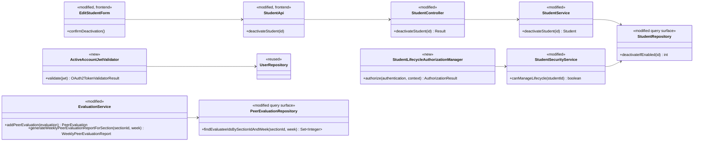
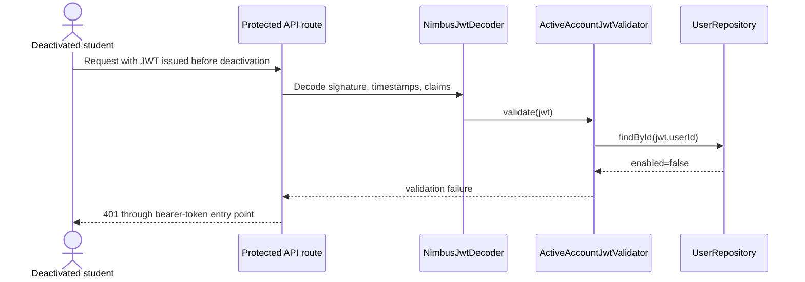

# Student Lifecycle (STU) Design

> Realizes: UC-STU-deactivate-student
> Depends on: FR-SEC-active-account, FR-SEC-deny-unauthorized, BR-student-lifecycle, BR-student-deactivation-effects, BR-submission-owed, BR-evaluation-editable-until-close
> See: [student use cases](../requirements/use-cases.md#student), [security requirements](../requirements/software-requirements-specification.md#security-and-authorization-requirements), [architectural design](architectural-design.md#crosscutting-concepts)
> Designed against `main` at `59f0267` (2026-11-06).

## Overview

The STU area adds the dedicated deactivation action that the existing generic student update path lacks. The action warns before it sends a request, admits only the course admin who owns the student's course or an instructor assigned to her course section, changes only the account's active flag, and leaves the student's team and submitted work intact. The same design closes the existing-session gap in FR-SEC-active-account: bearer-token validation consults the current account row, so deactivation rejects the student's next protected request instead of waiting for the two-hour JWT to expire.

The design extends the foundation's existing `student`, `evaluation`, and `security` packages. It creates no new feature slice and changes no Level-1 component boundary.

## Components and classes



- **Frontend, modified:** `frontend/src/pages/students/EditStudentForm.vue` removes the status switch and adds a destructive action shown only when the loaded student is active. `frontend/src/apis/student/index.ts` and `types.ts` add the dedicated call and response type. `Students.vue` reloads the table after the dialog reports a completed deactivation.
- **Student area, modified:** `StudentController` exposes the action and `StudentService` changes only `enabled`. `StudentRepository.deactivateIfEnabled` performs one conditional update (`enabled=true` to `false`) and returns its affected-row count, so concurrent confirmations cannot both report success. The generic `updateStudent` path no longer changes `enabled`, so it cannot bypass confirmation.
- **Authorization, new and modified:** `StudentLifecycleAuthorizationManager` rejects callers without an instructor/admin authority, reads only the route's `studentId`, and delegates ownership checks to `StudentSecurityService`. The service admits an instructor assigned to the student's course section or the course admin who owns its course and fails closed for an unresolved id. `SecurityConfiguration` applies it to the new PATCH and composes it with `UserOwnershipAuthorizationManager` on the existing student-detail GET, so the student may still read herself while both lifecycle actors can complete step 2.
- **Authentication, new:** `ActiveAccountJwtValidator` composes with the decoder's standard JWT validation and loads the current account by the immutable `userId` claim already carried by the token; it rejects a missing, unknown, or disabled account. Basic login continues to use `MyUserPrincipal.isEnabled()`.
- **Evaluation, modified:** `EvaluationService` rejects a new evaluation whose evaluatee is disabled with `You cannot submit a peer evaluation for a deactivated student.` Its course-section report obtains the evaluated student ids once through `PeerEvaluationRepository.findEvaluateeIdsBySectionIdAndWeek` and includes an inactive student only when that set contains her id. Existing update behavior remains governed by BR-evaluation-editable-until-close.
- **Error mapping, new:** `StudentAlreadyDeactivatedException` maps to `409 CONFLICT` in `ExceptionHandlerAdvice`.

## Sequence

```mermaid
sequenceDiagram
    actor A as Course admin / Instructor
    participant SPA as SPA (EditStudentForm)
    participant AM as StudentLifecycleAuthorizationManager
    participant SC as StudentController
    participant SS as StudentService
    participant SR as StudentRepository

    A->>SPA: View student details (step 2)
    A->>SPA: Deactivate student (step 3)
    SPA-->>A: Consequences and confirmation (step 4)
    alt actor cancels (4a)
        A->>SPA: Cancel
        SPA-->>A: Close warning; no request
    else actor confirms (step 5)
        SPA->>AM: PATCH /students/{studentId}/deactivation
        alt actor lacks lifecycle authority (5a)
            AM-->>SPA: 403 Forbidden; no change
        else actor is authorized
            AM->>SC: allow
            SC->>SS: deactivateStudent(studentId)
            SS->>SR: deactivateIfEnabled(studentId)
            alt affected rows = 0 (already inactive, 3a)
                SS-->>SPA: 409 Conflict; no change
            else affected rows = 1
                SS->>SR: findById(studentId)
                SS-->>SC: Student
                SC-->>SPA: 200 StudentDto
                SPA-->>A: Student deactivated (step 6)
            end
        end
    end
```

### Existing-session revocation



## API contract

| Endpoint or check | Caller | Request | Success | Errors and extensions |
|---|---|---|---|---|
| `GET /api/v1/students/{studentId}` (existing, widened for step 2) | The student herself through `UserOwnershipAuthorizationManager`, or either lifecycle actor through `StudentLifecycleAuthorizationManager` | Existing path variable | Existing `200` student details | Everyone outside those relationships: `403`; unresolved id fails closed. |
| `PATCH /api/v1/students/{studentId}/deactivation` | A course admin who owns the student's course, or an instructor assigned to her course section, enforced by `StudentLifecycleAuthorizationManager` before the API deny-all catch-all | No body; the authorized path variable is the entire command | `200` `Result` with the updated `StudentDto` and message `Deactivate student successfully` | Unrelated instructor or student: `403` and no change (5a). Already inactive: `409 CONFLICT`, `Student is already deactivated.`, and no save (3a). An unresolved id fails closed at the authorization layer and is not disclosed. |
| `PUT /api/v1/students/{studentId}` (existing, narrowed) | Existing `UserOwnershipAuthorizationManager` rule | Existing student update payload; `enabled` is no longer applied even if supplied | Existing `200`; username, first name, last name, and email may change as today | A supplied `enabled` value is ignored. Deactivation is available only through the dedicated route. |
| Bearer-token validation for protected requests | Any caller presenting a JWT | Existing JWT; standard signature/time validation plus lookup by immutable `userId` claim | Validation succeeds only while the current account exists and is enabled | Missing, unknown, or disabled account id: `401` through `CustomBearerTokenAuthenticationEntryPoint`, including a token issued before deactivation (FR-SEC-active-account). |

The frontend warning says that deactivation immediately ends access, including the current session; leaves the student on her current team; stops her reminders and prevents new peer evaluations of her; preserves her submitted weekly activity reports and peer evaluations; and lets reactivation restore access to the same team. Cancel closes the warning without calling the API.

## Key decisions

**A command endpoint, not generic update.** The dedicated `PATCH` route is the only path that changes a student's active flag, and the edit form no longer offers a status switch. Rejected: retaining `enabled` mutation in `updateStudent`, because a caller could bypass the required warning and confirmation.

**Repeated deactivation is a conflict, including concurrent confirmation.** A conditional repository update changes the flag only while it is true; zero affected rows becomes `StudentAlreadyDeactivatedException`. Rejected: silent idempotence, because extension 3a requires the actor to be told that no change occurred; rejected: read-then-save, because two concurrent requests could both read active and both report success.

**Lifecycle-specific authorization.** The new manager requires an instructor/admin authority and checks the student's course relationships. Rejected: `UserOwnershipAuthorizationManager`, because that manager deliberately admits the student herself; rejected: an instructor-role check alone, because it would admit an instructor from another course section.

**The existing detail route participates in the use case.** The GET rule composes user ownership with lifecycle authority, while the PATCH uses lifecycle authority alone. Rejected: changing `UserOwnershipAuthorizationManager` globally, because its other routes have different write semantics; rejected: leaving the GET unchanged, because an owning course admin who is not assigned to the course section could deactivate through the API but could not complete step 2.

**Immediate revocation through current account state.** `ActiveAccountJwtValidator` performs one primary-key lookup by the JWT's `userId` claim for every presented bearer token and composes with the decoder's standard validation. Rejected: lookup by token subject/username, because username is editable and would invalidate an otherwise-active session; rejected: waiting for JWT expiry, which violates FR-SEC-active-account; rejected: a token revocation table or account-version claim, which adds storage and lifecycle machinery the current scale does not need.

**Team membership survives deactivation.** No team association is changed. Rejected: removing the student, which would erase her team context from historical course-section reports and require manual reassignment after reactivation.

**Historical evidence without future empty rows.** A set-valued repository query obtains the student ids evaluated in the requested course section and week; the report includes active team members plus inactive team members in that set. Rejected: including every inactive student forever, which creates empty future rows; rejected: filtering every inactive student, which hides saved evaluations.

**New evaluations stop; saved evaluations keep their ordinary lifecycle.** Creation checks the evaluatee's active flag, while update continues to use the stored evaluation and its normal submission-window rule. Rejected: deleting or freezing existing evaluations at deactivation, which would contradict the retention policy and BR-evaluation-editable-until-close.

## Data model

No delta. The design reuses `PeerEvaluationUser.enabled` and the existing `Student`–`Team`, `Student`–`Section`, and `PeerEvaluation` relationships in the SRS [Business Domain Model](../requirements/software-requirements-specification.md#business-domain-model). No migration or seed-data change is required.

## Reuse and cross-cutting behavior

- Authentication retains HTTP Basic for login and Nimbus JWT for bearer requests; the new validator adds the current-account condition required by FR-SEC-active-account.
- Authorization retains the route-first, fail-closed convention and the existing `Result` error envelope.
- `SubmissionStatusService` is unchanged: its existing active-account filter already implements BR-submission-owed for reminders and submission-status reports.
- The existing Axios response interceptor already clears local authentication and redirects to login after the deactivated student's next `401`.
- No architecture-of-record edit is needed; the change remains within the existing foundation and performance-tracking components.

## Tests

| Flow | Level | Assertion |
|---|---|---|
| Main service behavior | Unit, `StudentServiceTest` | An active student becomes inactive, is saved once, and retains the identical team reference. |
| Assigned instructor | Integration, `StudentIntegrationTest` | An instructor assigned to the student's course section receives `200`; the response and stored student are disabled. |
| Owning course admin | Integration, `StudentIntegrationTest` | The course admin can GET the student and receives `200` from deactivation even when she is not separately assigned to the course section. |
| Warning consequences | Cypress, `student-deactivation.spec.cy.js` | The warning names immediate access loss, team retention, reminder/evaluation effects, record retention, and same-team reactivation before Confirm is available. |
| Cancel (4a) | Cypress, `student-deactivation.spec.cy.js` | Cancel closes the warning and the intercepted PATCH call count remains zero. |
| Already inactive (3a) | Unit + integration | The service throws without saving; the endpoint returns `409` with the specified message and leaves the row unchanged. |
| Unauthorized actor (5a) | Integration, `StudentIntegrationTest` | An unrelated instructor and a student receive `403`, and the account remains active. |
| Existing session | Integration, security test | A student token issued before deactivation receives `401` on the next protected request. |
| Future login | Integration, security test | Disabled credentials cannot obtain a token. |
| Generic-update bypass | Unit + integration | Supplying `enabled=false` to the generic update route does not change the active flag. |
| Reminder consequence | Existing `SubmissionStatusServiceTest` plus regression run | An inactive student owes neither item and active teammates need not evaluate her. |
| New evaluation of inactive student | Unit + integration, evaluation tests | Creation is rejected with `INVALID_ARGUMENT` and `You cannot submit a peer evaluation for a deactivated student.`; no evaluation is saved. |
| Saved evaluation remains editable | Unit, `EvaluationServiceTest` | An evaluation created before deactivation can still be updated while its ordinary window is open. |
| Historical weekly report | Unit, `EvaluationServiceTest` | An inactive team member with a saved evaluation in the requested week is included with that evaluation. |
| Later weekly report | Unit, `EvaluationServiceTest` | An inactive team member with no saved evaluation in the requested week is omitted. |

## Open risks

- Bearer authentication adds one indexed user lookup per authenticated request. This favors immediate revocation and simple correctness over a cache or revocation store; Project Pulse's classroom scale makes the trade-off acceptable.
- The repository has Cypress end-to-end infrastructure but no component-test harness. The cancellation test therefore runs through the student-management page with the API call intercepted.
